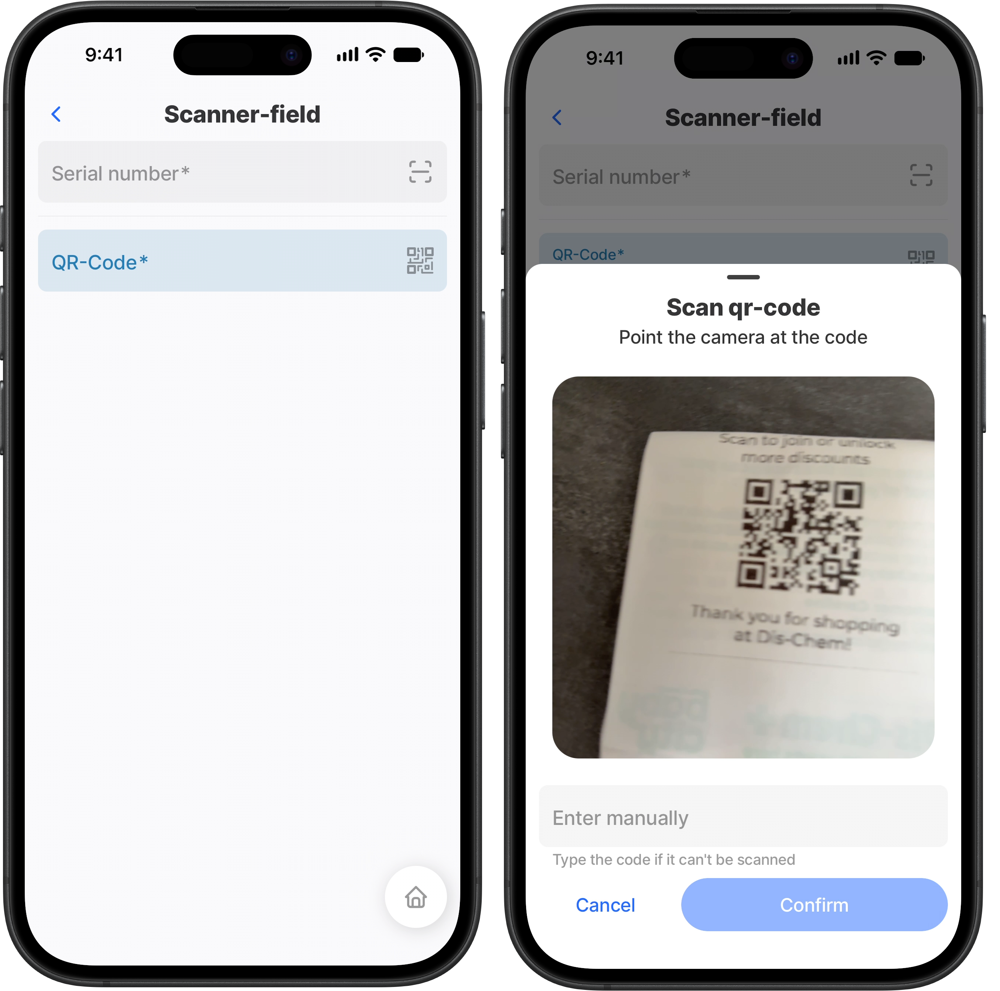

# scanner-field



The `scanner-field` component captures a serial number, QR code or barcode directly in a form. It displays as a text field with a scan icon.

Tap the field to open the scanner. A successful scan updates the field value and triggers `onChange`, just like typed input. Use it in a [jig\_default.md](<../../docs/Jig Types/jig_default.md> "mention") inside a [form.md](../../docs/Components/form/form.md "mention") or as a standalone field.&#x20;

The scanner supports QR, EAN-13, EAN-8, Code 128, Code 93, and Code 39 codes.



<figure><figcaption></figcaption></figure>




The scanner sheet includes **Enter manually**. It closes the scanner and opens the keyboard for the field. When the user leaves the field, tapping it opens the scanner again.


## Configuration options



<table><thead><tr><th width="198.38671875">Property</th><th>Description</th></tr></thead><tbody><tr><td><code>instanceId</code></td><td>A unique identifier for the scanner field.</td></tr><tr><td><code>label</code></td><td>The field label. It also becomes the scanner title when <code>scanner.title</code> is not set.</td></tr><tr><td><code>isRequired</code></td><td>Set to <code>true</code> to require a scanned or manually entered value.</td></tr><tr><td><code>isDisabled</code></td><td>Set to <code>true</code> to prevent input and opening the scanner.</td></tr><tr><td><code>isHidden</code></td><td>Set to <code>true</code> to hide the field.</td></tr><tr><td><code>helperText</code></td><td>Guidance displayed below the field when no error exists.</td></tr><tr><td><code>errorText</code></td><td>Validation feedback displayed below the field.</td></tr><tr><td><code>initialValue</code></td><td>The initial field value when the form loads.</td></tr><tr><td><code>scanner.title</code></td><td>The scanner sheet title. Defaults to <code>label</code>.</td></tr><tr><td><code>scanner.description</code></td><td>Supporting text shown in the scanner sheet.</td></tr><tr><td><code>onChange</code></td><td>An action triggered after a scan or manual value change.</td></tr><tr><td><code>onBlur</code></td><td>An action triggered when the field loses focus.</td></tr></tbody></table>

## Behavior

* Cancelling a scan keeps the current field value.
* The field does not open a keyboard or show a cursor by default.

## Examples and code snippets

### Scan a serial number

This form lets a technician scan an equipment serial number. If the label is damaged, they can select **Enter manually** and type the value.

```yaml
children:
  - type: component.form
    instanceId: equipment-form
    options:
      children:
        - type: component.scanner-field
          instanceId: serial
          options:
            label: Serial number
            isRequired: true
            scanner:
              title: Scan serial
              description: Point the camera at the device label
          onChange:
            type: action.set-jig-state
            options:
              changes:
                serial: =@ctx.components.serial.state.value
```

The scanned value is available through `=@ctx.components.<instanceId>.state.value`. Use it in validation, state actions, or form submission.

### Scan a QR-code

This form lets you scan an QR-code. If the code is damaged, they can select **Enter manually** and type the value.

```yaml
children:
  - type: component.scanner-field
    instanceId: QR-code
    options:
      color: color1
      icon: qr-code
      label: QR-Code
      scanner:
        title: Scan qr-code
        description: Point the camera at the code
```

## See also

* [form.md](../../docs/Components/form/form.md "mention")
* [open-scanner.md](../../docs/Actions/open-scanner.md "mention")
